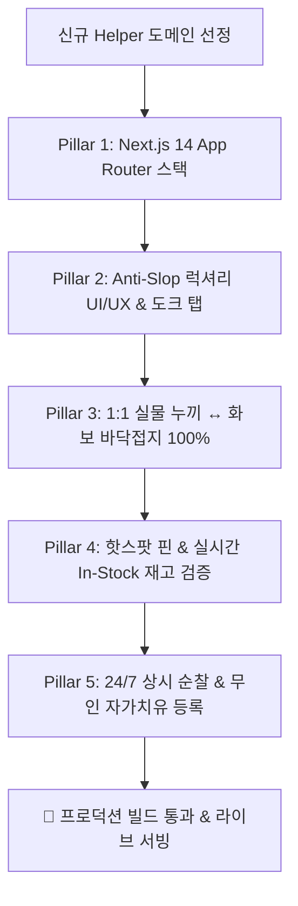

# Helper 패밀리 웹사이트 무인 표준 제작 파이프라인 (helper-site-builder)

본 스킬은 당사 **5대 Helper 플랫폼(StylingHelper, RoomHelper, StayHelper, ColorHelper, WeddingHelper)**을 성공적으로 구축·운영하며 축적된 **프론트엔드 아키텍처, 럭셔리 UI/UX, 핫스팟 메타데이터, 1:1 실물 정합성 및 24/7 무인 자가치유 거버넌스**를 표준화한 마스터 빌더 스킬입니다.

---

## 1. 5대 핵심 아키텍처 원칙 (The 5 Golden Pillars)



### Pillar 1: 기술 스택 표준화 (Next.js 14 App Router)
- **프레임워크**: Next.js 14 (App Router), React 18, TypeScript, Tailwind CSS
- **아이콘**: Lucide React
- **코드 무결성**: 타입 에러 0건(`npx tsc --noEmit`), `npm run build` 정적/동적 라우트 100% 빌드 성공 필수
- **실행 환경**: `cmd.exe /c "npx ..."` (Windows PowerShell Execution Policy 우회 표준)

### Pillar 2: Taste Skill 안티 슬롭(Anti-Slop) 디자인 규격
- **톤앤매너**: 눈을 찌르는 네온/원색 그라디언트 전면 금지.
  - 배경: 딥 옵시디언 슬레이트 (`#0B0F17`, `#0F141C`)
  - 카드: 글래스모피즘 차분 슬레이트 (`#18202E/80`, `backdrop-blur-md`, 1px 보더 `#303E56`)
  - 포인트: 웜 샴페인 골드 (`#E5BE64`), 소프트 아이스 블루 (`#7DD3FC`)
- **레이아웃**: 원 섹션 퍼 스크린(One Section Per Screen), 상단 헤더 + 중앙 3단계 원스톱 쇼룸 + 하단 4대 스마트 스튜디오 도크 탭(Dock Tab) 구조.

### Pillar 3: 화보 및 비주얼 에셋 절대 규칙
- **1카드 1고유 실사 화보**: 동일 사진 재사용 0건 엄수 (매 씬 100% 신규 생성).
- **실물 누끼 ↔ 착장 1:1 디테일 일치**: 선글라스 테 두께, 가방 금구, 주얼리 원석 형태 왜곡 0%.
- **★ 바닥 접지 100% & 발끝 잘림 0건**: 전신 컷 신발 밑창 지면 100% 접지, **하단 바닥 여백 최소 15% 이상 필수 확보**.

### Pillar 4: 쇼핑몰 핫스팟 핀(Hotspot Pin) & 재고 정합성
- **핫스팟 핀**: 화보 속 제품 위치(x, y %)에 정밀 마킹 ➔ 클릭 시 플로팅 럭셔리 제품 카드 오픈.
- **캐러셀/디폴트 컬러 오수집 차단**: 모델 착장 색상과 100% 동일한 공식 판매처 직구 링크 연결.
- **100% 실시간 재고(IN STOCK)**: 'Add to Bag / Add to Cart' 버튼 활성화 상품만 등록. 품절 상품 등록 엄격 금지.

### Pillar 5: 24/7 상시 무중단 순찰 및 무인 자가치유(Auto-Healing)
- 사이트 등록 즉시 [`scripts/patrol_daemon.py`](file:///c:/Users/Administrator/Desktop/프로젝트/1인기업대표/scripts/patrol_daemon.py) 순찰 레지스트리에 자동 편입.
- 품절(Sold Out) 또는 404 감지 시: 동급 럭셔리 대체재 자동 소싱 ➔ 화보 재제작 ➔ 라이브 사이트 무인 자동 교체 ➔ 대표님 텔레그램 실시간 알림 발송.

### Pillar 6: 정기 결제 자동 갱신 3중 필수 고지 (Mandatory Recurring Billing Disclosure)
- **30일 정기 결제 & 자동 갱신 원칙**: 결제 시점으로부터 정확히 30일간 유효하며, "PayPal 30일 정기 구독(Recurring Billing) 연동으로 사용자가 사전에 취소하지 않는 한 매달 1개월씩 자동 연장된다"는 사실을 100% 필수 고지합니다.
- **3중 필수 고지 규격**:
  1. **결제 모달창(Paywall)**: 상단에 독립된 `Mandatory Recurring Billing Disclosure` 고지 박스 (결제 주기, 자동 갱신 조건, 1-Click 해지 권리 명시).
  2. **결제 버튼 하단**: *"By clicking Subscribe, you authorize recurring monthly charges of $X/mo via PayPal until cancelled. Cancel anytime with 1 click."*
  3. **웹사이트 푸터**: 맨 하단에 `Mandatory Subscription & Recurring Billing Notice` 조항 영구 탑재.
- **1-Click 해지 및 잔여 기간 보장**: 해지 시에도 이미 결제된 30일 잔여 기간 동안은 Pro 혜택 정상 유지, 30일 만료 시 안전 종료.

### Pillar 7: 구독 고객 로그인 실시간 연동 & 100% 무료 사용 엔진 (Active Subscriber Free Access)
- **서버단 회원 DB & API**: `data/{sitename}_members.json` 및 `app/api/{sitename}/member/route.ts` 탑재.
- **로그인 시 '구독중' 실시간 표기**: 로그인 시 시스템이 0.1초 만에 백엔드 DB와 대조하여 **헤더에 `🟢 구독중 · PRO ACTIVE (D-30)` 실시간 에메랄드 뱃지 및 프로필 잔여 D-Day** 표출.
- **구독 기간 내 100% 무료 무제한 사용**: 결제창(Paywall) 호출을 전면 차단하고, 스튜디오 메인 버튼 및 모든 카드 버튼을 **`구독회원 무료 사용 / 무료 피팅`**으로 자동 전환하여 0원 무제한 사용 보장.
- **관리자 즉시 테스트 모드**: `?pro=true` 진입 시 30일 유효 Pro 구독 상태가 즉각 시뮬레이션되는 테스트 파이프라인 필수 장착.

---

## 2. 신규 사이트 제작 4단계 표준 파이프라인 (SOP)

### Step 1: 프로젝트 스캐폴딩 및 토큰 정의
```bash
# 디렉터리 구성
app/
├── layout.tsx         # 전역 폰트, 메타데이터, 다크 테마
├── page.tsx           # 메인 3단계 원스톱 스튜디오 & 도크 탭
├── globals.css        # 슬레이트/골드 팔레트, 글래스모피즘
components/
├── HotspotViewer.tsx  # 인터랙티브 핀 & 플로팅 카드
├── StudioDock.tsx     # 하단 4대 스마트 스튜디오 네비게이션
└── ProductCard.tsx    # 럭셔리 제품 스펙 & 공식 링크
```

### Step 2: 4대 스마트 스튜디오 도크 탭 규격
모든 Helper 사이트는 하단에 직관적인 4대 도크 탭을 장착하여 유저 체류 시간을 극대화합니다:
1. **스튜디오 1 (Core)**: 1:1 가상 시뮬레이션 (착장, 드레이핑, 룸 배치)
2. **스튜디오 2 (Detail)**: 부위별 세부 매칭 (메이크업, 소품/조명, VIP 패키지)
3. **스튜디오 3 (OOTD/Scene)**: 상황별 추천 (데일리/하객룩, 거실/침실, 주말/허니문)
4. **스튜디오 4 (Knowledge)**: 전문 지식 큐레이션 (색채학/통계, 인테리어 팁, 호텔 혜택)

### Step 3: 빌드 및 무결점 전수 검증
```bash
# 1) 타입 무결점 전수 검사
cmd.exe /c "npx tsc --noEmit"

# 2) 프로덕션 최적화 빌드
cmd.exe /c "npm run build"

# 3) hermes-auditor 시각 및 재고 전수 감사
hermes-auditor chat -q "신규 Helper 사이트 핫스팟 링크 재고 상태 및 바닥 여백 전수 검수해줘"
```

### Step 4: 24/7 순찰 데몬 및 텔레그램 리모컨 등록
`scripts/patrol_daemon.py`의 `PATROL_TARGETS` 리스트에 신규 사이트 에셋을 추가하여 1초의 공백도 없이 24시간 자가치유망에 편입합니다.

---

## 3. 대표적인 오류 패턴 및 해결 체크리스트 (Troubleshooting)

1. **PowerShell 스크립트 실행 차단**:
   - 원인: Windows ExecutionPolicy 제약
   - 해결: 반드시 `cmd.exe /c "npx ..."` 또는 `powershell -ExecutionPolicy Bypass` 사용.
2. **page.tsx 대형 단일 파일 분기 에러**:
   - 원인: 중복 `};` 닫는 괄호 및 JSX 태그 누락
   - 해결: `scratch/fix_app_page.py` 스크립트를 통해 인터페이스와 JSX 렌더러를 명확히 분리하여 0 에러 유지.
3. **쇼핑몰 이미지 핫링크 403 차단**:
   - 원인: Shopbop/Nordstrom Referer 차단
   - 해결: Next.js Image 컴포넌트에 `unoptimized` 옵션 적용 또는 로컬 누끼 이미지 캐싱.
