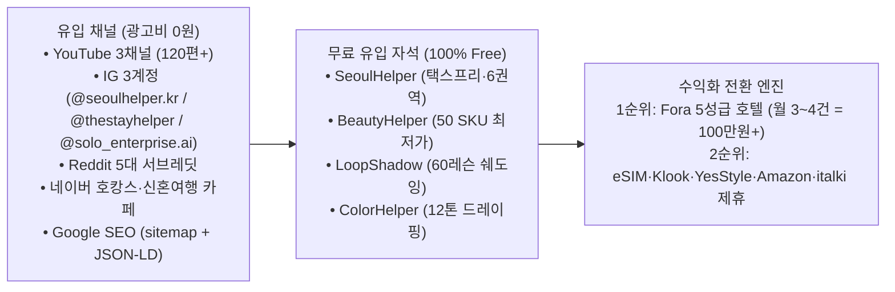

# 1인 기업 전사 마케팅 전략 및 30일 실행계획서 (2026년 12월)

> **주관**: 제3본부 (마케팅·그로스 본부 4개 팀) | **예산**: **월 0원 (100% 오가닉·자동화)**  
> **최종 목표**: ① **30일 내 Fora 5성급 호텔 예약 3~4건 성사 (월 100만 원+ 현금 매출)** ② **일일 무료 사이트 순방문자(UV) 100→300명 돌파** ③ **제휴 파트너 트래킹 링크 100% 장착**

---

## 1. 핵심 마케팅 아키텍처 (3단 무료→수익 퍼널)

---

## 2. 채널별 역할 분담 및 주간 실행 루틴 (비용 0원)

| 채널 | 담당 계정/자산 | 타겟 고객 | 핵심 콘텐츠 포맷 | 주간 실행 빈도 | 연결 랜딩 |
|---|---|---|---|---|---|
| **1. 네이버 카페 (즉시 현금 1순위)** | 대표님 네이버 계정 (호캉스·신혼여행·일본/발리 카페) | 한국인 5성급 호캉스·신혼여행 예약자 | 정보 공유형: *"포시즌스·파크하얏트·조선팰리스 공시가 그대로 조식2인+\$100 무료 받는 법"* | **주 2회** (화·목) | `SeoulHelper` + Fora 인테이크 |
| **2. 인스타그램 3축 (브랜드·신뢰)** | `@seoulhelper.kr` (서울·K-뷰티) `@thestayhelper` (5성급 Fora VIP) `@solo_enterprise.ai` (AI·1인기업) | 글로벌 서울 여행객 + 국내 호캉스/AI 관심층 | 5~7장 고화질 캐러셀 (실물 호텔·서울 권역·가격차 비교) + 대표님 릴스 | **계정별 주 2~3회** (Aside 활용) | 바이오 링크 → `/seoulhelper`, `thestayhelper.com` |
| **3. 유튜브 3대 외국어 (에버그린 무인)** | `KoreanLoop` (EN) `Hola Coreano` (ES) `LanguageLoop` (KR) | 외국인 서울 여행·한국어 학습자 + 한국인 5개국어 학습자 | 매일 10초 쇼츠 자동 예약 + 설명란 3종 무료 링크 영구 내장 | **매일 자동** (12/05까지 예약 완료) | `/seoulhelper`, `/loopshadow`, `/beautyhelper` |
| **4. 글로벌 커뮤니티 (고전환 유입)** | Reddit `u/jayyoun84` (`r/koreatravel`, `r/kbeauty`, `r/Korean`, `r/luxurytravel`, `r/SideProject`) | 검색 의도가 확실한 글로벌 여행·뷰티·언어 유저 | 본문 링크 0건 · 첫 댓글 링크 배치 · 3시간+ 쿨다운 + 질문글 가치 답변 | **주 3회** (포스트 2 + 가치댓글 5) | 각 타겟 무료 툴 |
| **5. 구글 검색 SEO (장기 자산)** | `personalcolorhelper.com` (`sitemap.xml` + 8대 JSON-LD) | 구글 검색 유입자 ("Korea tax free calculator", "Romand lowest price US" 등) | Google Search Console 색인 등록 + 주간 SKU/레슨 자동 확장 | **매주 일 03:00** 자동 확장 | 전 9대 페이지 |

---

## 3. 30일 단계별 실행 로드맵 (11/28 ~ 12/28)

### 1주차 (11/28 ~ 12/04): 수익화 배관 완성 & 첫 Fora 문의 확보
1. **제휴 파트너 ID 발급 & 링크 교체 (가장 시급)**:
   - 현재 일반 링크 상태인 **Airalo(eSIM 15~20%) · Klook(5~8%) · YesStyle/Amazon US · italki** 어필리에이트 가입 후 `data/seoulhelper_curated.json`·`data/beautyhelper_products.json`에 트래킹 코드 일괄 교체.
2. **Google Search Console(GSC) 사이트맵 제출**:
   - `personalcolorhelper.com/sitemap.xml` 1회 제출 → 구글 검색 노출 개시.
3. **인스타 모바일 바이오 링크 세팅**:
   - `@seoulhelper.kr` → `https://personalcolorhelper.com/seoulhelper`
   - `@thestayhelper` → `https://thestayhelper.com`
4. **Fora 첫 영업 개시**:
   - 네이버 호캉스·신혼여행 카페 2건 게시 (`docs/plans/2026-11-27_Fora_월100만원_실행키트.md` 활용)
   - Reddit `r/Korean` (`LoopShadow`) + `r/luxurytravel` (서울 5성급 VIP 비교) 게시

### 2주차 (12/05 ~ 12/11): 콘텐츠 2배 확장 & 유튜브 12월 중순 버퍼 확보
- 유튜브 3채널 **12/06~12/15(10일치)** 선제 제작·예약 (`0원 로컬 렌더링`) + OAuth 7일 만료 사전 갱신(`12/02`).
- `@seoulhelper.kr`에 **BeautyHelper 가격차 TOP 5 캐러셀**(Rom&nd·TIRTIR·Dasique -26% 비교) 및 **한국 택스프리 환급 가이드 캐러셀** 게시.
- `SeoulHelper`에 **인천공항→서울 교통 비교(AREX vs 리무진 vs 택시)** 미니 위젯 추가 (검색 유입 2배).

### 3주차 (12/12 ~ 12/18): Fora 전환 최적화 & 해외 럭셔리 확장
- 1~2주차 유입 데이터(`auto_daily_traffic_dashboard.py` + Vercel Analytics) 분석 → 클릭률 상위 2개 채널에 리소스 80% 집중.
- `@thestayhelper`에 **겨울·연말 도쿄(아만·포시즌스)·발리(불가리·카펠라) Fora VIP 5선** 캐러셀 게시 (객단가 \$4,000+ 고액 건 타겟).

### 4주차 (12/19 ~ 12/28): 월 100만 원 결산 & 자동화 고도화
- Fora 예약 성사 건수·제휴 클릭수·유튜브/웹 유입 월간 결산.
- 성과 상위 포맷을 제3본부 표준 스킬로 승격해 2027년 1월 자동 반복.

---

## 4. 제3본부 4개 팀 일일·주간 KPI 관리표

| 팀명 | 핵심 KPI (30일 목표) | 자동 추적 도구 |
|---|---|---|
| **SEO·검색 유입팀** | 구글 색인 100% · BeautyHelper 70 SKU · LoopShadow 80레슨 | `auto_weekly_content_expander.py` |
| **SNS·커뮤니티 실행팀** | 주간 IG 6건 + Reddit 3건 + 네이버 카페 2건 (계정 밴 0건) | `auto_community_safe_dispatcher.py` + Aside |
| **트렌드·카피·릴스 지원팀** | 매일 09:00 릴스 기획팩 배달 30/30일 | `auto_reels_morning_pack.py` |
| **제휴·전환(CRO) 성과분석팀** | **Fora VIP 문의 10건+ / 예약 확정 3~4건 (월 100만 원+)** · 매일 21:00 대시보드 | `auto_daily_traffic_dashboard.py` |
