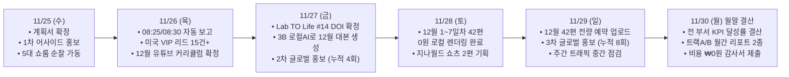

# 📋 2026년 11월 말(11/25 ~ 11/30) 전사 부서별 목표치 및 실행 계획서

> **작성일**: 2026-11-25 | **대상 기간**: 2026-11-25(수) ~ 2026-11-30(월) *(6일간)*  
> **총괄 보고**: 비서실장 하나(Hana) | **예산 한도**: **₩0원** *(100% 로컬·무료 도구 한정, 유료 API 호출 시 사전 승인 필수)*

---

## 🎯 1. 전사 11월 말 핵심 4대 마일스톤

1. **트래픽 0 ➔ 100명 돌파**: 현재 1명 수준인 웹 유입을 미국 VPN 비낚시 오가닉 홍보(어사이드 협업 포함)로 **합산 방문자 100명+ / PV 250회+** 달성
2. **유튜브 무중단 12월 버퍼 선제 확보**: 11/25~11/30 기예약 42편 완주 + **11/28(토)까지 12월 1~7일차 42편 사전 예약 완료** *(버퍼 5일 절대 사수)*
3. **비용 누수 ₩0원 완전 봉쇄**: 11월 잔여 6일간 구글/외부 유료 API 추가 과금 **₩0원** 유지
4. **자율 2중 경영 루프 정착**: 각 본부 부장의 **선제적 자율 검수·업무지시·재촉** + 매일 **08:25(제4본부 리서치) ➔ 08:30(하나 전사 통합 보고)** 6일 연속 100% 가동

---

## 🏛️ 2. 부서별 정량 목표치 (KPI) & 부장 검수 기준

### 📱 비서실 직속 — 셀하나(CellHana) 운영부 *(관할: 비서실장 하나)*
| 담당 | 11/30 목표치 (KPI) | 측정 방식 |
| :--- | :--- | :--- |
| **셀하나 운영 전담원** | • 하루 최소 업무 3종(앱 `:3000` 가동 · 수신함 동기화 · 링크 점검) **6/6일 100% 이행 (18/18건)** • 전사 아침 08:30 통합 보고 **6/6일 무결점 텔레그램 발송** • 대표님 2회 반복 지시 감지 시 **즉시 `.agent/skills/` 스킬화 (누락 0건)** | `hana_morning_all_hands_report.py` 일일 로그 & 텔레그램 영수증 |

---

### 🏢 제1본부 — 커머스·웹 본부 *(관할: 커머스·웹 부장)*
| 산하 부서 | 11/30 목표치 (KPI) | 부장 검수·재지시 게이트 |
| :--- | :--- | :--- |
| **① 플랫폼 개발팀** | • Helper 5대 사이트 프로덕션 정상 응답률 **100%** (`tsc` 에러 **0건**) • WeddingHelper PayPal 결제 검증 후 생성 흐름 최종 점검 완료 | 빌드 에러 1건이라도 발견 시 즉시 반려·수정 |
| **② 쇼룸 품질·순찰팀** | • 매일 1회 5대 쇼룸 링크·DOM 순찰 **6/6일 완료** • 품절(`Sold Out`) / 404 데드링크 **0건** 유지 | 품절 링크 적발 시 0원 범위 내 즉시 비활성화/교체 지시 |
| **③ 미국 소싱·아비트라지팀** | • NordVPN 미국 시애틀 IP 기반 25%+ 할인 럭셔리 핫딜 **일 3건 (누적 18건+)** 발굴·DB 갱신 | 비공식 그레이마켓 링크 혼입 시 즉시 반려 |

---

### 🎬 제2본부 — 글로벌 미디어 본부 *(관할: 글로벌 미디어 부장)*
| 산하 부서 | 11/30 목표치 (KPI) | 부장 검수·재지시 게이트 |
| :--- | :--- | :--- |
| **① 외국어 팩토리팀** | • 11/25~11/30 기제작 42편 무결점 공개 모니터링 • **12월 1~7일차 신규 배치 42편** (`LanguageLoop 30 + KoreanLoop 6 + Hola Coreano 6`) **11/28(토)까지 0원 로컬 렌더링 완료** | Shorts Safe Zone 잘림·어휘 주석 누락·발음 오독 발견 시 즉시 재렌더링 지시 |
| **② 편성·예약 운영팀** | • 12월 1~7일차 42편 **11/29(일)까지 전량 황금 시간대 예약 업로드 완료** *(11/30 기준 잔여 버퍼 **7일** 확보)* | `notifySubscribers=False` 위반 또는 쿼터 오류 방치 시 즉시 재지시 |
| **③ 시그니처 채널팀** | • `지나월드`: 신규 쇼츠 기획·자막 검수 **2편+** 완료 • `Lab TO Life #14`: Nature/PubMed DOI HTTP 200 검증 완료 대본 1편 확정 | 지나월드 부모 실명·슬로우모션 1건이라도 발견 시 즉시 반려 / DOI 404 시 즉시 교체 |

---

### 📈 제3본부 — 그로스·홍보 본부 *(관할: 그로스·홍보 부장)*
| 산하 부서 | 11/30 목표치 (KPI) | 부장 검수·재지시 게이트 |
| :--- | :--- | :--- |
| **① 글로벌 커뮤니티팀** | • 미국 VPN 기반 비낚시 오가닉 홍보(Reddit `r/SideProject`·X, 어사이드 협업 포함) **4대 사이트 각 2회 이상 = 총 8회+ 스팸 필터 통과 생존 게시** | `?lang=en` 쿼리·낚시 문구·가격표·필터 삭제(`Removed`) 발견 시 즉시 수정 재지시 |
| **② 트렌드·카피 지원팀** | • 대표님 직접 제작 인스타 릴스·쇼츠용 **손실회피 55.7% 훅 카피팩 6세트 (매일 1세트)** 제공 *(AI 임의 영상 제작·업로드 0건 엄수)* | 릴스 임의 제작 시도 시 즉시 중단·반려 |
| **③ 리드·전환(CRO)팀** | • 5대 사이트 합산 주간 방문자 **1명 ➔ 100명+ / PV 250회+** 돌파 • 미국 고관여 VIP 리드 DB **8건 ➔ 25건+** 확장 (`us_luxury_vip_leads.json`) • 매일 동적 최근 7일 Vercel 트래픽 집계 (`analyze_weekly_traffic.py`) | 하드코딩 수치·출처 불명 리드 발견 시 즉시 반려 |

---

### 🛡️ 제4본부 — 전략·재무·보안 본부 *(관할: 전략·재무·보안 부장)*
| 산하 부서 | 11/30 목표치 (KPI) | 부장 검수·재지시 게이트 |
| :--- | :--- | :--- |
| **① 재무·비용 감사팀** | • 11/25~11/30 외부 유료 API 추가 과금 **₩0원** 방어 • 로컬·Vercel 하드코딩 유료 키·시크릿 **0건** 유지 (11/30 월말 비용 결산서 제출) | 유료 키 1건이라도 감지 시 즉시 차단·보고 |
| **② 보안·인프라팀** | • Windows 안전 부팅 및 중복 프로세스 **0건** 유지 • 5대 유튜브 OAuth 토큰 만료(12/02 예정) 전 **11/30 사전 갱신 경보 발령** | 좀비 프로세스 발견 시 즉시 정리 |
| **③ 로컬 AI 모델링팀** | • `hana-deeptech:3b`, `hana-langloop:3b` 실전 투입 **100%** (12월 외국어 대본 1차 초안 0원 오프라인 생성 검증) • Unsloth 데이터셋 **676건 ➔ 750건+** 확충 | 3B 모델 응답 지연(>15초) 또는 포맷 깨짐 시 Modelfile 재튜닝 지시 |
| **④ 센컴·퀀텀 리서치팀 (트랙 A)** | • 매일 08:25 독립 리서치 **6/6일 발행** + **11/30 「11월 센컴·퀀텀 월간 인텔리전스 종합 보고서」 1부 제출** | AIDC M&A 트랙과 기사·딜 혼선 1건이라도 발견 시 즉시 분리 반려 |
| **⑤ AIDC 전력 M&A팀 (트랙 B)** | • 매일 08:25 독립 리서치 **6/6일 발행** + **11/30 「11월 AIDC 전력·냉각 상장사 M&A 월간 브리핑」 1부 제출** | 센컴·퀀텀 트랙과 혼선 또는 미검증 공시 수치 발견 시 즉시 반려 |

---

### 🚀 제5본부 — 신사업 개발부 *(★신설 · 관할: 신사업 개발 부장)*
| 산하 부서 | 11/30 목표치 (KPI) | 부장 검수·재지시 게이트 |
| :--- | :--- | :--- |
| **① 신사업 발굴·시장검증팀** | • **심층 리서치 & 벤치마킹**: 유사 사업 전수 조사 ➔ 우리 강점 결합 ➔ 비용 상정 및 이해타산(ROI) 검증 완료된 **신사업 후보 3건** 발굴 • 이해타산 통과 최우선 1순위 **정식 사업계획서 1부** 대표님께 제출 *(승인 대기)* | 유사 사업 벤치마킹 누락, 차별화 미흡, 또는 이해타산(손익) 불명확 시 즉시 반려·재조사 지시 |
| **② 고속 MVP 프로토타이핑팀** | • 대표님 승인 시 **전 부서(제1~4본부) 업무 분배** 착수 • **일일 1회 전 부서 합동 미팅(Daily Sync)** 주재 (`daily_cross_division_sync.py`) ➔ 부서 간 의견 공유·조율 및 중요 결정사항 대표님 승인 상신 • 11/30까지 1순위 사업 **MVP 프로토타입(또는 랜딩 시안) 1종** 착수·제출 | 부서 간 조율 누락 또는 대표님 미승인 중요 결정 임의 집행 시 즉시 중단·반려 |

---

### 🎨 제6본부 — 디자인부 *(★신설 · 관할: 디자인 부장)*
| 산하 부서 | 11/30 목표치 (KPI) | 부장 검수·재지시 게이트 |
| :--- | :--- | :--- |
| **① UI/UX·브랜드 디자인팀** | • Helper 5대 사이트 클린 화이트·블랙 미니멀 UI 통일성 감사 완료 • 신사업 1순위(`BeautyHelper`) 승인 시 **랜딩/비교 UI 디자인 시안 1종** 즉시 납품 | 모바일 레이아웃 깨짐·가독성 저하·다크/네온 남용 발견 시 즉시 반려·수정 지시 |
| **② 비주얼·썸네일·검수팀** | • 12월 유튜브 42편 썸네일·Shorts Safe Zone **100% 사전 검수** • 5대 쇼룸 화보 1:1 정합성·바닥 접지 15% 검수 완료 (발끝 잘림 **0건**) | 발끝 잘림·글자 잘림·과도한 원색 1건이라도 발견 시 즉시 재작업 지시 |

---

## 📅 3. 11월 잔여 6일(11/25 ~ 11/30) 일자별 실행 로드맵

---

## ⚖️ 4. 자율 집행 & 보고 프로토콜

* **각 본부 부장 (1차 루프)**: 매일 스스로 산하 부서 산출물을 점검하며, **미달 시 자체 재지시 / 결과물 부재 시 즉각 업무지시·재촉**을 선제 실행합니다.
* **비서실장 하나 (2차 루프)**: 대표님께 재촉 여부를 묻지 않고 유휴 본부를 즉시 가동하며, **매일 아침 08:30 전사 통합 보고** 및 **11/30(월) 20:00 11월 월말 최종 KPI 결산서**를 대표님 텔레그램으로 보고합니다.
